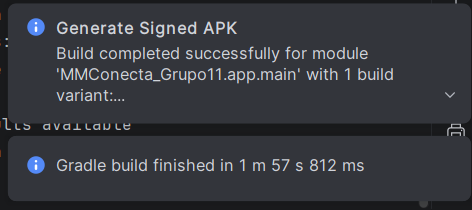
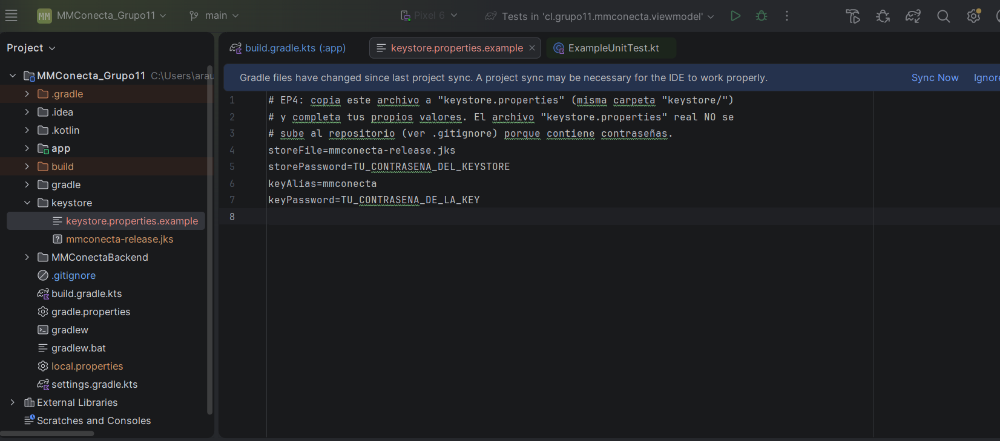

# MMConecta

Proyecto Android (Kotlin + Jetpack Compose, arquitectura MVVM) con backend propio en Spring Boot. Desarrollado para la Evaluación Parcial 4 (EP4) de la asignatura DSY1105.

## 1. Nombre del proyecto

**MMConecta** — Grupo 11.

## 2. Integrantes

- Francisca Araceli Gómez Cancino

> EP4 desarrollada de forma individual.

## 3. Funcionalidades

- **Login** de usuario contra el backend propio (Retrofit + Spring Boot).
- **Catálogo** de contenidos (Panadería, Pastelería, Chocolatería) con filtro por categoría.
- **Detalle** de cada contenido del catálogo.
- **Favoritos**: marcar/desmarcar, ver solo favoritos, persistencia local en el dispositivo.
- **Perfil de usuario** editable, con validación de campos y persistencia local.
- **Foto de perfil** capturada con la cámara del dispositivo (con solicitud de permiso en tiempo de ejecución y manejo de los casos en que se rechaza o no hay cámara disponible).
- **Notificaciones locales** (con solicitud de permiso en tiempo de ejecución en Android 13+).
- **Pruebas unitarias** (JUnit5 + Kotest + MockK + kotlinx-coroutines-test) sobre los ViewModels de Login y Home.
- **APK de release firmado**, con la configuración de firma hecha reproducible vía Gradle (no solo con el asistente de Android Studio).

Más detalle de la arquitectura y de las pruebas en [`docs/MMConecta_Documentacion_Tecnica_EP4.docx`](docs/MMConecta_Documentacion_Tecnica_EP4.docx).

## 4. Endpoints utilizados

La app consume un backend propio en Spring Boot (`MMConectaBackend/`), que cumple el doble rol de **API externa consumida desde la app** y **microservicio propio desarrollado para el EP4**.

URL base:
- Backend corriendo localmente: `http://localhost:8080`
- Desde el emulador de Android Studio: `http://10.0.2.2:8080/` (alias que usa el emulador para apuntar al computador anfitrión)

| Método | Ruta | Descripción |
|---|---|---|
| GET | `/api/catalogo` | Lista todo el catálogo |
| GET | `/api/catalogo?categoria={categoria}` | Filtra por categoría (`Panaderia`, `Pasteleria`, `Chocolateria`) |
| GET | `/api/catalogo/{id}` | Detalle de un contenido por id |
| POST | `/api/usuarios/login` | Body `{ "username": "...", "password": "..." }`. Responde `200 { success: true }` o `401 { success: false, message: "..." }` |

## 5. Pasos para ejecutar

### Backend (Spring Boot)

1. Abrir una terminal dentro de la carpeta `MMConectaBackend/`.
2. Ejecutar:
   ```
   mvn spring-boot:run
   ```
3. El servicio queda escuchando en `http://localhost:8080`.

### App Android

1. Abrir la carpeta raíz del proyecto en Android Studio.
2. Esperar a que sincronice Gradle (la primera vez puede demorar).
3. **Solo si se quiere generar un APK de release firmado:** copiar `keystore/keystore.properties.example` a `keystore/keystore.properties` y completar los valores propios del keystore (este archivo no se sube al repositorio). Para correr la app en modo debug/desarrollo este paso no es necesario.
4. Con el backend ya corriendo (paso anterior), ejecutar la app (▶ Run) sobre un emulador o un dispositivo físico.
5. Iniciar sesión, navegar el catálogo, filtrar por categoría, marcar favoritos, editar el perfil, tomar una foto de perfil y probar las notificaciones locales.

### Pruebas unitarias

Desde Android Studio: clic derecho sobre `app/src/test/java/.../viewmodel` → **Run Tests**, o desde terminal:
```
./gradlew test
```

## 6. Captura del APK firmado y .jks

**Generación del APK de release firmado:**



**Keystore (`.jks`) generado, dentro del proyecto (excluido del repositorio por `.gitignore`):**


